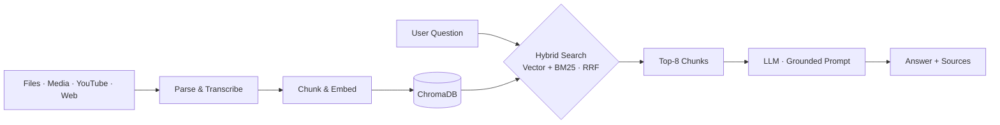

<h1 align="center">Hi, I'm Deva Nithin Sai 👋</h1>
<h3 align="center">AI/ML Engineer · Generative AI · RAG & Agentic Systems</h3>

  

  
  
  <!-- To add a resume button: upload your resume (e.g. Google Drive, view-only link) and uncomment the next line -->
  <!--  -->

---

## 🧠 About Me

I'm a final-year **B.Tech student in Artificial Intelligence & Machine Learning** at **SVKM's NMIMS MPSTME, Shirpur** (graduating 2027).
I build AI systems end to end, from model design and evaluation to the backend that serves them.

- 🔍 Building **retrieval-augmented generation (RAG)** systems with hybrid search and grounded, source-cited answers
- 🤖 Designing **agentic workflows** with LangGraph, custom MCP tools and human-in-the-loop approval
- ⚡ Benchmarking **model quantization (GPTQ)** for efficient deployment of vision-language models
- 📏 Measuring what I build with golden datasets, retrieval metrics (hit@k, MRR) and faithfulness checks
- 🎯 Open to **ML Engineer, GenAI Developer and AI Engineer** roles

---

## 🛠️ Tech Stack

| Area | Tools |
|---|---|
| **Languages** |    |
| **ML & Deep Learning** |     |
| **GenAI & LLMs** |     |
| **Retrieval** |    |
| **Backend & Deployment** |      |
| **Tools** |    |

---

## 🚀 Featured Projects

### 🎬 [Multimodal RAG Knowledge Assistant](https://github.com/Devanithin/multimodal-rag-assistant)

Upload PDFs, Word docs, CSV/Excel files, audio/video, YouTube videos or web pages, then ask questions in natural language and get answers **grounded in that content, with source citations**.

- **Hybrid retrieval:** semantic search (ChromaDB + all-MiniLM-L6-v2) and BM25 keyword search, merged with Reciprocal Rank Fusion
- **Evaluated on a golden dataset:** hybrid retrieval reaches **96.2% hit@8** (vs 69.2% for semantic search alone), MRR 0.701
- **Grounded answers:** a grounded prompt raised faithfulness from 80.6% to **100%** and correct refusals on unanswerable questions from 80% to **100%**
- **Optimized:** caching the BM25 index and removing a duplicate search cut hybrid retrieval from **~85 ms to ~14 ms**
- Audio/video transcription with Faster-Whisper, FastAPI backend, Streamlit frontend, Dockerized

`Python` `FastAPI` `LangChain` `ChromaDB` `BM25` `Hugging Face` `Faster-Whisper` `Streamlit` `Docker`

---

### ✍️ Grounded Technical Research & Blog Writing Agent
<!-- When this repo is public, turn the heading above into a link: ### ✍️ [Grounded Technical Research & Blog Writing Agent](https://github.com/Devanithin/REPO_NAME) -->

A multi-agent pipeline that writes technical blog posts in which **every claim is cited** to a retrieved arXiv or web source.

- **Agent pipeline:** planner → research → outline → draft → verify → revise
- **Custom MCP server** exposing arXiv and Tavily tools, with TF-IDF re-ranking to improve paper retrieval over arXiv's literal keyword search
- **Human-in-the-loop:** an approval step using LangGraph interrupts and SQLite checkpointing, so paused runs resume across separate API requests

`Python` `LangGraph` `MCP` `arXiv API` `Tavily` `SQLite`

---

### 📉 Quantizing Document Parsing in PaddleOCR-VL-1.6
<!-- When this repo is public, turn the heading above into a link -->

Benchmarked **8-bit and 4-bit GPTQ** versions of a 0.9B document-parsing vision-language model against BF16 on all **1,651 OmniDocBench v1.6 pages**, scoring text, tables, formulas and reading order separately.

- **8-bit:** throughput up **14.5%**, weight memory down **19%**, energy per page down **16%**, with **no quality loss** (96.33 vs 96.34)
- **4-bit:** 19.7% faster but lost **2.62 points**, 90% of it in tables and formulas
- **Conclusion:** 8-bit is the better choice for deployment

`Python` `PyTorch` `GPTQ` `Hugging Face` `Vision-Language Models`

---

## 🎓 Education & Certifications

- 🎓 **B.Tech, Artificial Intelligence & Machine Learning**, SVKM's NMIMS MPSTME, Shirpur (2023 – 2027)
- 📜 **Deep Learning**, IIT Ropar (NPTEL): Elite + Silver, 84% (2025)
- 📜 **Machine Learning**, BHU (SWAYAM): 83% (2025)

---

## 📊 GitHub Analytics

<!--
  Cards switch between dark and light automatically to match the viewer's GitHub theme.
  Tweaks for later, once you have more activity:
    - remove "&hide_rank=true" from the stats card to show your rank letter
    - Jupyter Notebook is hidden from Top Languages because notebook outputs (images) inflate its size
-->

  <picture>
    <source media="(prefers-color-scheme: dark)" srcset="https://github-readme-stats.vercel.app/api?username=Devanithin&show_icons=true&include_all_commits=true&count_private=true&hide_border=true&hide_rank=true&theme=github_dark" />
    
  </picture>
  <picture>
    <source media="(prefers-color-scheme: dark)" srcset="https://github-readme-stats.vercel.app/api/top-langs/?username=Devanithin&layout=compact&hide_border=true&hide=jupyter%20notebook&exclude_repo=Blood-Donor-System,Local-Repo&langs_count=8&theme=github_dark" />
    
  </picture>

  <picture>
    <source media="(prefers-color-scheme: dark)" srcset="https://streak-stats.demolab.com?user=Devanithin&hide_border=true&theme=github-dark-blue" />
    
  </picture>

  <picture>
    <source media="(prefers-color-scheme: dark)" srcset="https://github-profile-summary-cards.vercel.app/api/cards/profile-details?username=Devanithin&theme=github_dark" />
    
  </picture>

<!-- Snake animation: generated by .github/workflows/snake.yml into the "output" branch. It shows a broken image until that workflow has run once. -->

  <picture>
    <source media="(prefers-color-scheme: dark)" srcset="https://raw.githubusercontent.com/Devanithin/Devanithin/output/github-snake-dark.svg" />
    
  </picture>

---

## 🤝 Let's Connect

I'm happy to talk about RAG, agents, LLM evaluation or opportunities in AI/ML.
Reach me on [LinkedIn](https://www.linkedin.com/in/deva-nithin-126781307/) or at **devanithin0303@gmail.com**.

  

